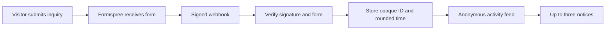

# Anonymous inquiry notifications

The site can show up to three stacked notices when real inquiries reach Matt.
This feature is **off by default** until the delivery and storage connections
are configured. There are no sample events in production and an email draft
does not create activity.

Notices show no names, locations, amounts, or form answers. They describe an
inquiry, not a purchase, booking, or paying client. Times use broad labels such
as “In the last hour.” Visitors can dismiss one notice or hide activity for the
rest of their visit. Motion follows their reduced-motion preference.

## Connect later

1. Activate Formspree delivery as described in [Intake delivery](intake.md).
2. Connect an Upstash Redis database to the Vercel project. Add its HTTPS REST
   URL and token as `UPSTASH_REDIS_REST_URL` and `UPSTASH_REDIS_REST_TOKEN`.
3. In Formspree, add a **Simple Webhook** pointing to the production site's
   `/api/activity` URL. Webhooks currently require a Professional or Business
   plan. Configure webhook signing and save the matching secret as
   `FORMSPREE_WEBHOOK_SECRET` in Vercel. Add the webhook payload's form identifier
   as `FORMSPREE_FORM_ID`.
4. Keep `PUBLIC_INQUIRY_ACTIVITY_ENABLED=false` while verifying a genuine test
   submission and its webhook delivery. Confirm that the API returns only
   opaque IDs and rounded timestamps, and that replaying the delivery does not
   create a second entry. Do not use a real client's details for setup tests.
5. Remove setup activity with `DEL afin:anonymous-inquiries:v1` in Redis. Set
   `PUBLIC_INQUIRY_ACTIVITY_ENABLED=true` and redeploy to enable notifications.

Keep credentials in Vercel's environment settings, never Git. Use separate
storage and secrets for preview and production. Disable the public flag and
redeploy to stop showing notifications. No account or paid service was created
as part of this implementation.

## Verification and retention

The server checks Formspree's HMAC signature over the timestamp and exact body,
accepts signatures within five minutes, and requires the configured form ID.
Browser-generated claims cannot add events. Delivery retries reuse an opaque,
secret-derived ID. Only that ID and a minute-rounded time enter Redis; the
webhook payload is neither stored nor logged by this code.

The feed exposes at most three events from the last 24 hours. Writes remove old
entries and cap storage at 100 events; the entire key expires after 24 hours
without an update. An old entry can remain stored until the next update or key
expiry, for at most 48 hours, but is never shown outside the 24-hour window.
Formspree has its own submission retention policy.

The browser stores only seen event IDs and the hide preference in session
storage. It polls every 90 seconds after an eight-second delay, pauses while
forms or overlays are active, and never posts intake answers to the feed.
Each stack stays for 12 seconds, with dismissal paused during hover or focus.
Unavailable storage or an empty feed produces no notifications.

Tests cover signatures, replay age, wrong forms, deduplication commands,
personal-data exclusion, stale events, stacking, dismissal, and empty feeds.

References: [Formspree webhooks](https://help.formspree.io/articles/plugins/webhooks),
[signature verification](https://help.formspree.io/articles/advanced-features/verify-webhook-signatures),
and [Upstash REST transactions](https://upstash.com/docs/redis/features/restapi).
