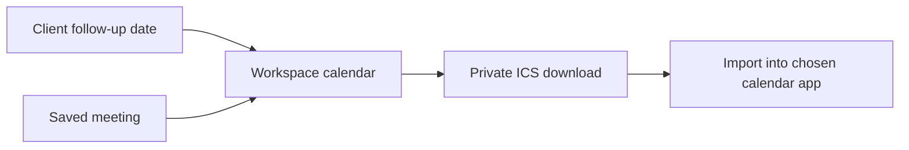

# Calendar and workspace search

## Plan a conversation

Open **Calendar → New meeting**, choose a client, and enter the title, start,
end, and optional location or video link. Meetings start as **Tentative**.
Change to **Confirmed** after agreeing the time, **Completed** after the session,
or **Cancelled** to keep a record without showing it in the default calendar.
Overlapping tentative or confirmed meetings display a warning; you can still save.

Month view shows an overview; select a date for its agenda. Week view uses a
seven-column calendar with a detailed agenda below. Day view focuses on one
day’s schedule. All three views share the same status filters. **Today** returns to the
current date. Click a meeting to edit, reschedule, or remove it. Removal requires
confirmation. Unsaved changes have a discard confirmation.

Client **Next follow-up** dates appear as all-day reminders. They are not booked
appointments. Click one to edit the client record. Archived clients no longer
produce follow-up reminders; their saved meetings remain available.

Times use the browser's time zone, displayed above the calendar and in the editor.
Saved meeting times use UTC so calendar apps can display the same instant locally.
Nonexistent times during the spring daylight-saving change are rejected. During
the repeated autumn hour, the browser chooses the earlier occurrence; schedule
outside that repeated hour if you need to avoid ambiguity. Recurring meetings and
automatic booking are not included.

## Download to a calendar app

Choose **Export all → Download .ics** and import the file into your preferred
calendar app. This uses the [iCalendar standard](https://www.rfc-editor.org/rfc/rfc5545).
The download includes every non-cancelled meeting and every current follow-up
reminder, regardless of the selected date or filter. Completed meetings are included.

The export contains client names, meeting titles, dates, and locations. It does
not contain coaching notes, intake answers, email addresses, or documents. Store
it privately and choose a private destination calendar.

This is a snapshot, not a live subscription or invitation. No email is sent.
Later edits and cancellations do not update an imported copy. Event IDs stay
stable, but apps handle repeated imports differently and may create duplicates.
For a full replacement, use a dedicated calendar and replace its imported events.

## Find things quickly

Press **Cmd+K** on macOS or **Ctrl+K** on Windows/Linux, or use the search button.
Search by client name, email, priority, meeting title, location, or status. Results
also include navigation and actions to create a client or meeting. Archived clients
remain searchable. Up to 30 results are shown; refine the query to narrow them.

Use the arrow keys to select, Enter to open, and Escape to close. Search locks
background scrolling and returns focus when dismissed. Other open editors keep
priority over the shortcut so unsaved changes cannot be bypassed. Search stays
inside the workspace; query text and client data are not sent to an external service.

## Connect and test

Apply [003_calendar.sql](../supabase/migrations/003_calendar.sql) after the workspace
migration. The `meetings` table allows only the configured owner's authenticated
session to read or change records. Updates and deletion check the last saved
version to avoid overwriting a concurrent edit. Meetings belong to clients and
are removed if the client is permanently deleted from the database.

Development preview includes fictional meetings. Changes stay in memory and reset
on reload or sign-out. Production still requires Matt's authenticated account and
Supabase configuration. Calendar export works locally without third-party credentials.

Checks cover time ranges, date boundaries, Unicode-safe export, owner-only policies,
concurrent edits, keyboard search, mobile layout, accessibility, and meeting workflows.
