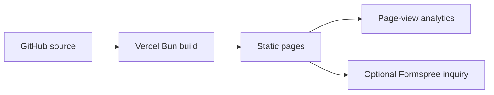

# Deployment and analytics

## Vercel

The public `smeltery/adamou-financial-consulting` repository is connected to Vercel.
The site is available at [adamou-financial-consulting.vercel.app](https://adamou-financial-consulting.vercel.app/). The checked-in
`vercel.json` uses Bun, builds with `bun run build`, and serves `dist/`.
No application server or database is required. Connect the GitHub repository
for automatic previews and production deployments from `main`.

Add `FORMSPREE_ENDPOINT` when the form is ready; see [intake setup](intake.md).
Add a custom domain in Vercel and follow the DNS records it provides.

## Web Analytics

The shared browser entry includes `@vercel/analytics`. Enable **Web Analytics**
in the Vercel project dashboard, then redeploy and visit the site. Confirm page
views in the dashboard; an SDK installation alone does not verify collection.

Analytics is disabled on localhost. Query strings and fragments are removed
before events are sent. No custom event sends intake answers, names, emails,
phone numbers, or free text. Vercel Web Analytics does not use analytics cookies.
The public `/privacy/` page describes analytics and inquiry delivery.

See Vercel’s [setup guide](https://vercel.com/docs/analytics/quickstart) and
[analytics privacy documentation](https://vercel.com/docs/analytics/privacy-policy).

## Operational checks

Check the homepage, brand download, direct contact links, and intake on a small
screen after deployment. Verify an invalid form cannot send, delivery errors
retain answers, and a successful test reaches the configured inbox.

Vercel adds hosting security controls; the repo also sends MIME-sniffing,
framing, referrer, and device-permission headers. Missing routes use `404.html`.
