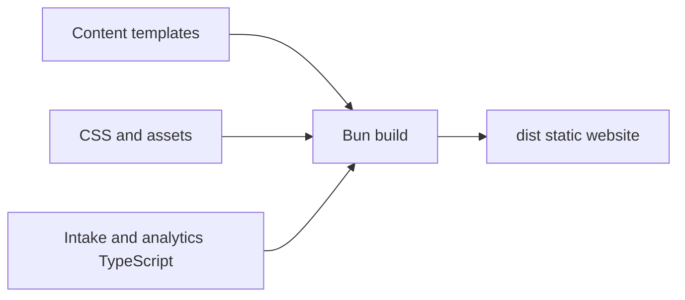

# Development

## Reproducible environment

```sh
flox activate
bun install --frozen-lockfile
bunx --bun playwright install chromium
bun run dev
```

Flox pins Bun and supplies Git and actionlint. Its activation hook sets
`core.hooksPath` to `.githooks`; the pre-commit hook runs the same check command
as CI inside Flox. `flox services start preview` is an alternative preview entry.

CI uses GitHub-hosted Ubuntu by default. Set the repository variable
`CI_RUNNER=blacksmith-2vcpu-ubuntu-2404` when Blacksmith is enabled for the repo.
The first Blacksmith run remained queued without a runner assignment.

The development server binds to localhost on port 3000. Re-run the build after
editing files; it intentionally has no framework or watcher.

## Checks

`./scripts/check.sh` checks formatting, Markdown, local documentation links, Mermaid
syntax, LOC budgets, strict TypeScript, inquiry tests, and the production build.
`actionlint` validates GitHub workflows in the shared `scripts/check.sh` entry.
Run `bun run format` to apply formatting.

Mermaid diagrams use flowchart syntax, validated by the official Mermaid parser.
Tests cover destination validation, email serialization, provider rejection,
network failure, and accepted submissions. Browser QA uses Maestri Portal.

## Architecture



`src/` contains page templates, shared layout, styles, and client behavior.
`scripts/` contains build, preview, and quality checks. `public/assets/` contains
the portrait and SVG mark. There is no client framework or database.

## Budgets

Tracked source, docs, scripts, and configuration have a 400-line file ceiling,
20 direct files per directory, and a 4,200-line overall ceiling. Generated
assets, lockfiles, and Flox metadata are excluded. Budgets live in
`scripts/budgets.json`; split by responsibility rather than compressing code.

Add new files to Git before running budget checks. CI always checks the tracked
snapshot. Dependencies and build output stay out of Git.

The 4,200-line budget includes expanded, distinct service, about, and approach pages, generated agent-readable content, submission celebration coverage, and eight tested financial calculators and keyboard site search. Shared sections and routing keep those additions small.
