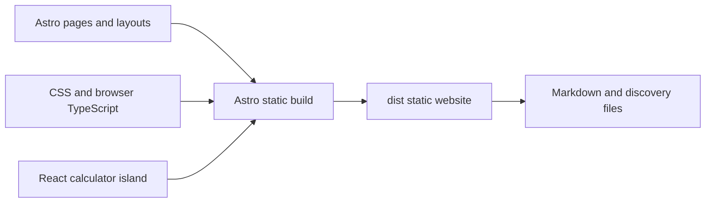

# Development

## Reproducible environment

```sh
flox activate
bun install --frozen-lockfile
bunx --bun playwright install chromium
bun run dev
```

Flox pins Node.js 24, Bun, Git, and actionlint and installs the pre-commit hook, which runs CI checks. Use `flox services start preview` for a managed preview.

CI uses GitHub-hosted Ubuntu by default. Set the repository variable
`CI_RUNNER=blacksmith-2vcpu-ubuntu-2404` when Blacksmith is enabled for the repo.

The Astro dev server uses localhost:3000 and updates automatically as you edit.
For production routing checks (including Markdown negotiation), run
`bun run build && bun run preview` instead. Stop the dev server first to free port 3000.

## Checks

`./scripts/check.sh` checks formatting, Markdown, local documentation links, Mermaid
syntax, LOC budgets, Astro and strict TypeScript checks, unit tests, the production
build, and desktop/mobile browser tests.
`actionlint` validates GitHub workflows in the shared `scripts/check.sh` entry.

Use `bun run format` to apply Prettier before committing. The Astro plugin formats
page and component markup alongside TypeScript, TSX, and CSS. `.prettierrc.json`
sets the shared formatting rules;
pre-commit and CI enforce them with `prettier --check`.

## Architecture



Source is grouped by responsibility:

| Directory         | Responsibility                                         |
| ----------------- | ------------------------------------------------------ |
| `src/pages/`      | File-based Astro routes and content                    |
| `src/components/` | Shared Astro navigation, forms, and sections           |
| `src/layouts/`    | HTML document, header, footer, and shared assets       |
| `src/site/`       | Business identity, metadata, and structured data       |
| `src/client/`     | Browser entry point, search, celebrations, and intake  |
| `src/styles/`     | Shared and page styles, in explicit build order        |
| `src/tools/`      | Calculator definitions, formulas, behavior, and styles |

`scripts/` holds build and quality checks; `public/assets/` holds images. Public URLs stay stable; Astro fingerprints compiled CSS and JavaScript for caching.

Content pages render as HTML at build time. Only `/tools/` loads React through
`CalculatorSuite.tsx` with `client:load`; other interactions use focused TypeScript
modules. Formulas stay in `math.ts`, separate from rendering. Without JavaScript,
all calculator formulas remain visible and inputs are disabled. The initial
example stays disabled until hydration so entered values cannot be overwritten.

`scripts/crawl.ts` derives Markdown and discovery files from the built pages, so
content has one source of truth. There is no application server or client router.

## Budgets

Tracked source, docs, scripts, and configuration have a 1,000-line file ceiling,
20 direct files per directory, and a 7,500-line overall ceiling. Generated
assets, lockfiles, and Flox metadata are excluded. See `scripts/budgets.json`.

Add new files to Git before running budget checks; CI checks the tracked snapshot.

Page navigation uses native CSS cross-document view transitions for a brief
blur and fade. Reduced-motion visitors get ordinary navigation; unsupported
browsers use a CSS arrival animation. Internal page links blur the outgoing content
while loading; a timeout and browser-back reset prevent a stuck blur. Links remain native, with no artificial loading
delay or JavaScript router. See [MDN’s view transition guide](https://developer.mozilla.org/en-US/docs/Web/CSS/Reference/At-rules/@view-transition).
Responsive line breaks retain whitespace after `<br />` so hiding a break cannot
join words. The Astro formatter uses strict whitespace sensitivity, and Astro
uses lossless HTML compression instead of JSX whitespace rules. This also
preserves spaces around inline links and emphasized words.

The mobile menu slides in from the right and fades its backdrop with CSS transitions and a closing animation. Reduced-motion visitors get an immediate open and close.

Search opens and closes with a short fade and lift. Result changes animate without delaying filtering; rapid input replaces the previous animation. All search motion respects reduced-motion preferences.

The overall LOC ceiling includes formatted Astro and React components. The per-file limit remains 1,000 lines; readability should not require compressing markup.

Separate logical steps and helper functions with blank lines. Keep imports at the top, and use short comments to explain non-obvious behavior or constraints rather than restating the code. Prettier preserves these intentional breaks.
