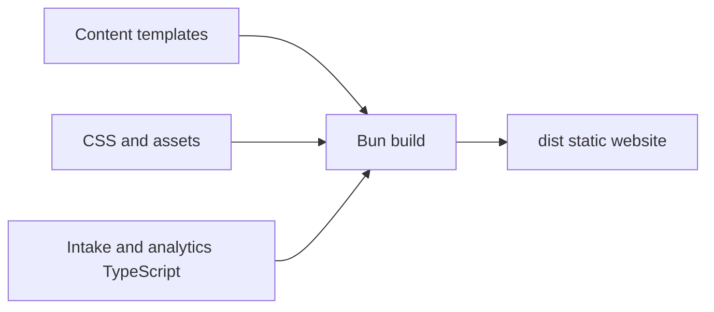

# Development

## Reproducible environment

```sh
flox activate
bun install --frozen-lockfile
bunx --bun playwright install chromium
bun run dev
```

Flox pins Bun, Git, and actionlint and installs the pre-commit hook, which runs CI checks. Use `flox services start preview` for a managed preview.

CI uses GitHub-hosted Ubuntu by default. Set the repository variable
`CI_RUNNER=blacksmith-2vcpu-ubuntu-2404` when Blacksmith is enabled for the repo.

The preview uses localhost:3000; rebuild after editing files.

## Checks

`./scripts/check.sh` checks formatting, Markdown, local documentation links, Mermaid
syntax, LOC budgets, strict TypeScript, inquiry tests, and the production build.
`actionlint` validates GitHub workflows in the shared `scripts/check.sh` entry.

Use `bun run format` to apply Prettier before committing. HTML template literals
carry a `/* HTML */` annotation so Prettier formats their contents, not just the
surrounding TypeScript. `.prettierrc.json` sets the shared formatting rules;
pre-commit and CI enforce them with `prettier --check`.

## Architecture



Source is grouped by responsibility:

| Directory         | Responsibility                                         |
| ----------------- | ------------------------------------------------------ |
| `src/pages/`      | Route content and page templates                       |
| `src/components/` | Shared layout, navigation, and sections                |
| `src/site/`       | Business identity, metadata, and structured data       |
| `src/client/`     | Browser entry point, search, celebrations, and intake  |
| `src/styles/`     | Shared and page styles, in explicit build order        |
| `src/tools/`      | Calculator definitions, formulas, behavior, and styles |

`scripts/` holds build and quality checks; `public/assets/` holds images. The build keeps public URLs and asset names stable.

## Budgets

Tracked source, docs, scripts, and configuration have a 1,000-line file ceiling,
20 direct files per directory, and a 7,000-line overall ceiling. Generated
assets, lockfiles, and Flox metadata are excluded. See `scripts/budgets.json`.

Add new files to Git before running budget checks; CI checks the tracked snapshot.

Page navigation uses native CSS cross-document view transitions for a brief
blur and fade. Reduced-motion visitors get ordinary navigation; unsupported
browsers use a CSS arrival animation. Internal page links blur the outgoing content
while loading; a timeout and browser-back reset prevent a stuck blur. Links remain native, with no artificial loading
delay or JavaScript router. See [MDN’s view transition guide](https://developer.mozilla.org/en-US/docs/Web/CSS/Reference/At-rules/@view-transition).
Responsive line breaks retain literal whitespace so hiding a break cannot join words.

The mobile menu slides in from the right and fades its backdrop with CSS transitions and a closing animation. Reduced-motion visitors get an immediate open and close.

Search opens and closes with a short fade and lift. Result changes animate without delaying filtering; rapid input replaces the previous animation. All search motion respects reduced-motion preferences.

The overall LOC ceiling includes expanded, formatted HTML templates. The per-file limit remains 1,000 lines; readability should not require compressing markup.
