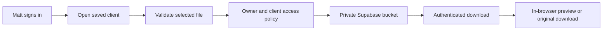

# Client documents

Open an existing client record and find **Documents**. Choose **Upload document**
to attach a signed contract, agreement, or supporting file. Save a new client
before adding files. Documents save immediately, independently of other edits
in the client form; closing the record does not undo an upload.

## Supported files and preview

- **PDF:** in-app page navigation and extracted page text when available.
- **PNG, JPG, WebP:** in-app image preview.
- **Word (.docx):** upload and download; open in your preferred document editor.
- **Limit:** 20 MB per file. Empty files, unsupported extensions, and obvious
  file-content mismatches are rejected before upload.

Use the eye icon to preview, the download icon for the original file, and the
trash icon to remove a file. Removal asks for confirmation and cannot be undone
through the app. Uploading another copy creates a separate file; existing signed
originals are never overwritten. The list includes file size and upload date.
Filenames are normalized for storage compatibility; file contents are preserved.

Preview cannot unlock password-protected PDFs or repair damaged files. Download
the original if the preview cannot render it. This feature stores documents;
it does not collect electronic signatures or verify that a signature is valid.

## Private storage setup

After configuring [the workspace](workspace.md), apply
[the document migration](../supabase/migrations/002_documents.sql) using the
Supabase SQL editor. It creates the private `client-documents` bucket, restricts
uploads to the supported types and size, and adds Matt-only storage policies.
No additional environment variables are needed.

Files use a client-specific folder and a unique identifier. The bucket is never
public. Preview and download use Matt’s authenticated session, not public or
shareable signed URLs. The app creates temporary browser object URLs and revokes
preview URLs when the preview closes. PDFs render locally without a third-party
conversion service. No document data is sent to analytics.

Verify setup with a test client and test file before using real contracts:

1. Upload and preview a PDF, then download it and compare it to the original.
2. Close and reopen the client; confirm the file remains attached.
3. Confirm that anonymous requests and a different signed-in user cannot list,
   download, upload, overwrite, or remove files.
4. Remove the test document and verify that it is no longer accessible.

Client archiving preserves attached files. Permanent client deletion requires
removing its documents through Supabase Storage first; a database trigger guards
against leaving files behind. Never delete Storage metadata directly with SQL:
use the app’s removal action or the Supabase Storage API/dashboard so the stored
bytes are removed too.

Supabase database backups do not include the document bytes. Configure a
separate backup and restoration procedure for Storage objects and agree a
retention policy before using real client documents. Previously downloaded
copies and backups have their own retention lifecycle.

## Development preview

In **Explore with sample data**, uploads, preview, download, and removal work
without authentication or network storage. Files stay in the current browser’s
memory and are cleared on sign-out or reload. Use sample documents for testing.
Production has no demo mode.

Automated checks cover file validation, original download bytes, PDF pagination,
removal confirmation, new-client gating, and owner-only database storage policies.
Live Supabase Storage behavior still needs verification after connecting credentials.
