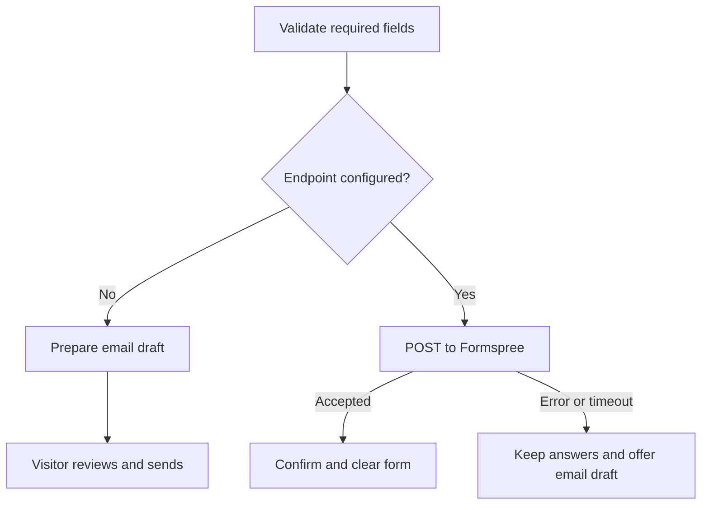

# Intake delivery

## Current behavior

Without `FORMSPREE_ENDPOINT`, the form prepares an email draft for the visitor
to review and send. It never displays a sent confirmation for that draft.
No inquiry is stored by this application.

## Enable Formspree

1. Create a form at [Formspree](https://formspree.io/) and verify Matt’s inbox.
2. Copy its endpoint, such as `https://formspree.io/f/yourformid`.
3. Add `FORMSPREE_ENDPOINT` in the Vercel project’s environment settings for
   the intended deployment environments.
4. Redeploy. The endpoint is embedded at build time and is public, not a secret.
5. Send a clearly labeled test inquiry and confirm it reaches Matt’s inbox.

For local testing, use a local `.env` file (ignored by Git). Bun reads it when
building. Never commit provider credentials or client submissions.

The form includes a honeypot, required consent, maximum input lengths, a
15-second timeout, and duplicate-click prevention while sending. Formspree
provides server-side submission handling. Configure its spam filtering and
allowed domains in the provider dashboard.

The site follows Formspree’s [JavaScript submission guidance](https://help.formspree.io/articles/building-your-form/submit-forms-with-javascript-ajax/).
Automated tests mock the provider; they do not contact Matt or prove inbox delivery.
