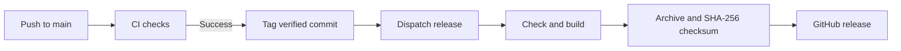

# Releases

The workflow follows HAB’s CI-triggered release pattern, adapted to static web
artifacts. The license is an exact copy of HAB’s license.

The first tag is `v0.1.0`; later releases increment the patch. The release
workflow verifies the tag’s ancestry and builds that exact revision. An
already-tagged revision does not create another tag. Automatic tagging uses
the completed CI commit, not a potentially newer unchecked `main`.

Releases contain `afin-site.tar.gz` and its SHA-256 checksum. These artifacts
use the email fallback unless the public Formspree endpoint is configured in
the release environment. Vercel builds separately with its own environment
settings and handles deployment independently from GitHub release packaging.
