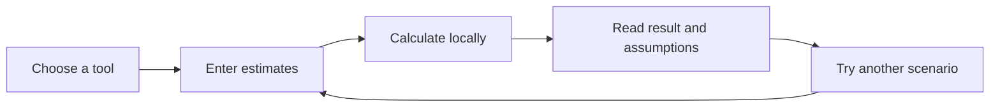

# Financial tools

Open `/tools/` and choose a calculator. Replace the example values with your own
estimates. Results update immediately; **Reset example** restores the defaults.
All currency amounts are USD. Inputs stay in memory in the browser and are not
saved, sent to Matt, or included in analytics. Reloading clears your changes.

| Tool           | Method                                                     | Assumptions                                                      |
| -------------- | ---------------------------------------------------------- | ---------------------------------------------------------------- |
| Monthly budget | Income minus expenses and planned allocations              | All values cover one month; income is after tax                  |
| Emergency fund | Essential expenses × selected months                       | No interest; coverage is your choice                             |
| Savings goal   | Remaining goal ÷ monthly contribution, rounded up          | Constant monthly contributions; no interest or withdrawals       |
| Debt payoff    | Add balance × APR / 1200, then subtract payment each month | Fixed APR and payment; no new charges or fees; 1,200-month limit |
| Net worth      | Total assets minus total debts                             | Current estimates; no selling costs or taxes                     |

A payment that cannot reduce debt returns an explanation instead of a false
payoff date. A completed savings goal returns zero months. Invalid or incomplete
inputs replace the result with a correction message.

These are original Afin implementations of common arithmetic tools, inspired by
[Calculum](https://calculum.dev/). No Calculum code or interface is embedded.
They provide educational estimates, not individualized financial advice.
JavaScript enables interactive calculation; formulas remain readable without it.

The formulas live in `src/tools/math.ts`, page definitions in `catalog.ts`, and
browser behavior in `client.ts`. Unit tests cover zero values, shortfalls,
rounding, interest, and impossible payoff scenarios. Browser tests cover all
five tools, resets, invalid inputs, and the absence of network requests.
