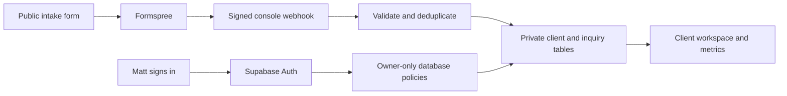

# Matt’s client workspace

The private React application lives in `apps/console`. The public Astro site
lives in `apps/site`. Both use Bun workspaces and the same Flox environment.
The workspace replaces a client-tracking spreadsheet with searchable records,
coaching notes, goals, lifecycle checklists, follow-ups, and business metrics.

## Daily workflow

1. Open **Inquiries** for new website introductions, or select **Add client** for
   a manual introduction. Email addresses identify existing clients.
2. Open a record to edit contact details, priorities, notes, and the next
   follow-up date. **Save client** persists the changes; unsaved changes prompt
   before dismissal.
3. Change the stage to **Onboarding** to add the starting checklist. Agree scope,
   fees, and the first meeting, then move the client to **Active**.
4. Add specific goals and mark them complete as work progresses. Use
   **Follow-ups** to see open clients in date order; the dashboard highlights
   overdue follow-ups. These are reminders inside the app, not scheduled emails.
5. Move a client to **Offboarding** for a closing checklist and summary. Archive
   after wrapping up. Archiving preserves their record and removes them from
   open follow-ups. Reopen by changing the stage from the Archive view.

The history shows the latest 50 changes and 50 submitted inquiries. It records
when a record changed and stage transitions, not copies of every note revision.
If another window changed a record, saving fails rather than overwriting it.
Close and reopen that record to see the newer version before applying your edits.

## Dashboard definitions

- **Active clients:** records currently in the Active stage.
- **New inquiries:** records currently in the New inquiry stage.
- **Overdue follow-ups:** non-archived records with a follow-up date before today.
- **Started coaching:** clients that have ever entered Active divided by all
  client records, including archived clients. This is an all-time ratio, not a
  date-cohort conversion metric.
- **New client records:** first records created in each of the last six months.
  Repeat website inquiries do not count as additional clients.
- **Goal progress:** completed goals divided by all recorded client goals.

Charts animate unless reduced motion is preferred. Each chart has a text data
alternative. Revenue is not estimated from client stages; payment collection,
billing and automated email campaigns are not included.

## Connect Supabase and sign-in

1. Create a Supabase project and apply
   [the migration](../supabase/migrations/001_workspace.sql) in its SQL editor.
2. Disable public sign-ups in Supabase Auth. Invite or create only
   `madamou@afin-consulting.com`, and have Matt verify his email.
3. Authorize that verified Auth user in the SQL editor:

   ```sql
   insert into public.workspace_owner (user_id)
   select id from auth.users
   where lower(email) = 'madamou@afin-consulting.com'
     and email_confirmed_at is not null;
   ```

   Confirm exactly one row exists in `workspace_owner`. Until it does, all
   client access is denied. The app cannot change this authorization table.

4. Configure the Supabase email sign-in template to display `{{ .Token }}`.
   Use production SMTP delivery. Matt requests a code and enters it in the app;
   no public registration or password-sharing flow is offered.
5. Set `VITE_SUPABASE_URL` and `VITE_SUPABASE_ANON_KEY` in the console’s Vercel
   project, then rebuild. The publishable/anon key is intentionally public;
   Postgres row-level security enforces authorization using Matt’s Auth UUID.
   Never put the service-role key in a `VITE_` variable.
6. Sign in as Matt and verify create/edit/archive/reopen against a test record.
   Verify that another account and an anonymous request cannot access any table.
   Remove the test record after verification.

Sessions and client records stay in memory, not local storage. Reloading the app
requires signing in again. Signing out clears the loaded records. There are no
third-party analytics or session recordings in the private app.

## Connect website intake

The public site continues sending to Formspree. Configure it using
[Intake delivery](intake.md). The console receives a separate signed webhook;
an email draft does not create a client record.



1. Add a Formspree Simple Webhook targeting the console’s `/api/intake` route.
   Formspree requires a plan with webhook support. Enable webhook signing.
2. Set server-only `FORMSPREE_FORM_ID`, `FORMSPREE_WEBHOOK_SECRET`,
   `SUPABASE_URL`, and `SUPABASE_SERVICE_ROLE_KEY` in the console project.
3. Redeploy and submit a test inquiry. Confirm its details appear in the record.
   Retry delivery and confirm one inquiry remains. Submit again with the same
   email and confirm the additional inquiry attaches without replacing edits.
4. Keep the separate [anonymous activity integration](activity.md) disabled until
   that feature is connected. The console endpoint never exposes a public feed.

The server verifies the signature over the exact request body with a five-minute
clock tolerance and checks the form ID. It copies only allowed intake fields.
A transaction deduplicates retries and matches repeat inquiries by normalized
email. Incoming inquiries do not automatically reactivate archived clients.
Storage failures return an error so delivery can be retried; monitor Formspree
webhook delivery logs and retry failed submissions there. No client payloads or
credentials are logged by the webhook code.

## Deployment, backups, and retention

Create a separate Vercel project from the same repository with root directory
`apps/console` and allow build access to files outside that directory. Its own
`vercel.json` configures the Vite build, API route, no-index and no-store headers.
The existing website project keeps repository root as its root directory, uses
root `vercel.json`, and serves `apps/site/dist`. Deploying the console without
credentials shows only the disconnected sign-in screen.

Client data lives in Supabase, not Vercel’s filesystem. Configure and verify
Supabase backups and a restoration procedure before storing real records.
Archiving is not deletion. Matt should agree a retention period; an authorized
operator can permanently delete a client in Supabase after removing its documents through Storage; deletion
cascades to their inquiries and history. Formspree copies have separate retention settings.
Never use production client records in preview deployments. Use a separate
Supabase project for testing.

## Local development and checks

```sh
flox activate
bun install --frozen-lockfile
bun run dev:console
```

Open `http://127.0.0.1:3100`. **Explore with sample data** is available only in
Vite development mode. Fictional records and edits live only in memory and reset
on reload. Production bundles exclude the fixtures and demo entry point.

`bun run check` checks both applications, validates docs and Mermaid, enforces
1,000 lines per file, exercises owner policies in a PostgreSQL test engine, and
runs desktop/mobile workflows and accessibility checks. Visual site checks also
run through `scripts/check.sh`, matching the pre-commit hook and CI.

## Documents

Attach contracts and supporting files to saved client records. See
[client documents](documents.md) for previews, supported formats, private storage
setup, backups, and development testing.

## Calendar and quick search

Use [Calendar and workspace search](calendar.md) to manage tentative and confirmed
meetings, see follow-up reminders, download a calendar snapshot, and find records
with Cmd+K or Ctrl+K.
